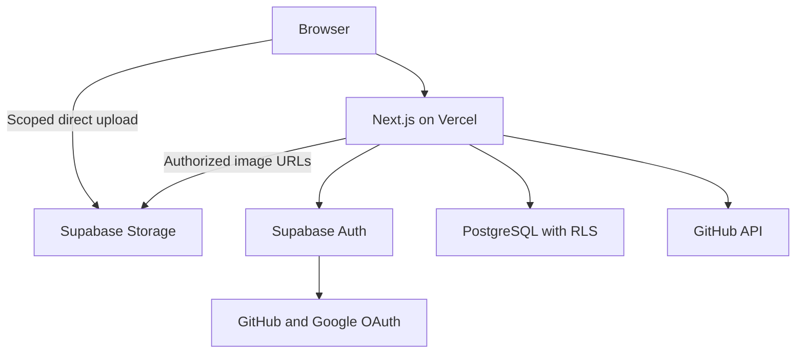
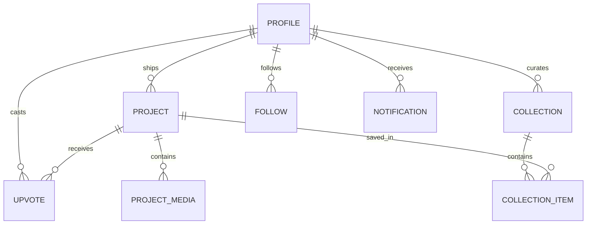

# ARK Product and Engineering Specification

Version 1.0 • 12 October 2026 • Initial beta below 100 makers

ARK is a developer launch discovery platform for completed, publicly available projects. Developers publish their work, build a public portfolio, follow makers, upvote projects, and curate public collections. This specification consolidates all six requirement rounds and defines the product, architecture, data model, interface, and delivery gates for the first public version.

Build one Next.js application backed by Supabase, deployed on Vercel. Complete every confirmed launch feature in internal milestones before opening the public beta. Use total upvotes for the default Explore order. Keep a separate Latest feed so new launches have a clear discovery route.

## 1 Product direction

### Audience and purpose

Primary users are developers and programmers who have shipped working projects. Visitors may browse without an account. The platform should help makers gain visibility, establish a portfolio, discover useful work, and form connections through following and public curation.

Projects are the main content. ARK does not require users to maintain an activity stream or write social posts. A maker's credibility comes from their work, connected GitHub identity, and accurately scoped repository verification.

### Launch scope

The public beta includes authentication, onboarding, profiles, project publishing and management, Explore and Following feeds, search and filters, reversible upvotes, public collections, following lists, in-app notifications, optional GitHub verification, external sharing, reporting, and admin moderation.

No comments, separate likes, direct messages, reputation score, badges for outstanding work, editorial promotion, paid placement, email notifications, product analytics, native mobile app, scheduled launches, or work-in-progress posts are included. Repository verification is a factual indicator, not an award or quality endorsement. Pricing and monetization are not defined for this release.

### Success without product analytics

Launch acceptance depends on working user journeys, correct permissions, reliability, and a small invited group successfully publishing real projects. Gather qualitative feedback directly from beta makers. Keep operational error and security logs; do not add behavioral events, session replay, tracking pixels, or analytics SDKs. Public upvote and follower counts are functional product data, not an analytics program.

## 2 Resolved decisions

Later explicit decisions take precedence over earlier choices. The implementation defaults below fill gaps; they are recommendations, not additional answers attributed to the user.

| Topic | Final rule | Reason |
|---|---|---|
| Product name | ARK throughout | ShipStory was an earlier label, not this product's name |
| Likes and upvotes | Upvotes only, removable | Round 3 replaces the separate like action |
| Equal visibility and popular ranking | Equal eligibility and rules; unequal exposure based on upvotes | Round 6 explicitly chooses popular first; identical exposure cannot coexist with that choice |
| Prominent grid | First six results of the selected feed, then a compact list | No editorial picks, paid slots, or separate promotion logic |
| GitHub onboarding | Import immediately for GitHub sign-in; offer a skippable connection step after Google sign-in | GitHub connection and ownership verification remain optional |
| Publishing eligibility | Active account with a trusted verified email or linked authenticated GitHub identity | Never accept a client-supplied verified flag |
| Complete public launch | Internal incremental implementation; public beta only after all launch gates pass | Milestones reduce integration risk without removing scope |
| Screenshots and videos | Upload screenshots; optional external demo-video URL | Avoid hosting and transcoding videos for a tiny beta |
| Public saving | Every collection, including default Saved, is public | Explicitly selected public collections; show this before first save |
| GitHub verification | Public repositories personally owned by the connected GitHub account | Meets minimal-permission requirements without claiming collaborators or organization membership prove ownership |
| Other social connections | Public links, labeled as links; only GitHub gets an authenticated connection indicator | No other developer social provider was specified for identity verification |
| Account settings | Private; projects, profiles, follower lists, and collections public | Private settings do not create private portfolios |

Recommended defaults: one maker per project; no self-upvotes or self-following; up to six profile pins; one primary category and up to ten stack tags; a stable project URL independent of its title; all durations and quotas below enforced server-side. Team publishing, organization verification, and private collections can be evaluated later.

## 3 Roles and permissions

| Capability | Visitor | Active signed-in user | Eligible maker | Admin |
|---|---|---|---|---|
| Browse public projects, profiles, collections and following lists | Yes | Yes | Yes | Yes |
| Search and filter | Yes | Yes | Yes | Yes |
| Upvote, save, follow, report | No | Yes | Yes | Yes |
| Publish | No | No, until eligibility met | Yes | Same eligibility for personal publishing |
| Edit, delete and pin projects | No | Own projects only | Own projects only | Hide or restore through moderation, not impersonation |
| Manage collections and profile | No | Own only | Own only | Moderate reported content through logged actions |
| Read notifications and account settings | No | Own only | Own only | No routine access to another user's settings |
| Review reports and suspend users | No | No | No | Yes |

A suspended account cannot mutate product data. Its projects, profile, and collections disappear from public discovery; its votes are excluded from visible totals. Suspension remains authoritative in database authorization, even if an old login session is valid. Signing in may show a restricted account notice and sign-out action. Suspension is an administrative block, not a new social feature allowing users to block each other.

## 4 User journeys and functional requirements

### Authentication and onboarding

1. Offer Continue with GitHub and Continue with Google. No password or email-only sign-in in this release.
2. Complete OAuth using managed Supabase Auth and an approved callback URL. Preserve only an internal, allowlisted return path.
3. Create one public profile for the auth user. Collect a unique ARK username before publishing or social writes.
4. Import available avatar, name and bio with a review screen. Never replace user-edited profile values automatically on later sign-ins.
5. If GitHub is connected, store its stable numeric account ID and public username. Google users can connect GitHub or skip.
6. Permit explicit identity linking from an authenticated account. Do not merge accounts using manually submitted email addresses or matching display names. Use the auth provider's supported identity-linking flow.
7. Handle denied permissions, duplicate usernames, already-linked identities, callback errors and expired sessions with recoverable messages.
8. Account settings support identity connection/disconnection, notification preferences, sign-out and account deletion. Require recent authentication for sensitive changes. Do not allow removing the final usable login identity.

Recommended username format: 3–30 lowercase letters, numbers and underscores; reserve system route names. Display names are independent of usernames. Username changes are allowed with the same checks; stable user IDs preserve relationships. Old username redirects are deferred, so warn that old profile links may stop resolving.

### Publish and manage a project

Use one page with labeled sections: basics, links, screenshots, stack and category, and final review. Drag-and-drop must have an equivalent file picker. This is a single-page workflow, not a wizard.

| Field | Requirement and recommended validation |
|---|---|
| Project name | Required, 2–80 characters |
| Tagline | Required, 10–160 characters |
| Description | Required, 100–10,000 characters; plain text or safely rendered restricted Markdown |
| Live website | Required for a website or hosted app; HTTPS |
| GitHub repository | Optional; valid public repository URL for verification |
| Launch destination | At least one working website/demo or public release/package/repository destination |
| Screenshots | 1–8 PNG, JPEG or WebP images; maximum 5 MiB each; recommended maximum decoded dimensions 4096 × 4096 |
| Cover | One selected screenshot; stable order and image alternative text |
| Demo video | Optional YouTube or Vimeo URL; link or consent-based embed; no autoplay |
| Category | Exactly one active primary category |
| Tech stack | 1–10 normalized stack tags |
| Launch confirmation | Maker confirms the project is completed enough to use and already publicly available |

The launch-destination rule supports libraries, CLI tools and open-source software without forcing a fake website. A repository counts only when it contains usable shipped software with clear run/install instructions or a release. An idea, abandoned placeholder, or coming-soon landing page does not qualify. Human review resolves reports; ARK does not claim to automatically judge completeness.

A project becomes public immediately when publishing succeeds. Screenshots upload into private staging first. Publishing is idempotent using a client-generated request key and a server-generated project UUID. Partial upload failures leave no public project. Retrying cannot create duplicate launches or follower notifications.

The maker can edit content, reorder or replace screenshots, change links and tags, delete the project, and pin it on their profile. Edits do not reset published_at, boost feed rank, or send a new launch notification. A changed repository link invalidates verification. Prevent publishing the same normalized launch URL or GitHub repository twice under the same maker; updates belong to the existing project. Different products on one host may use distinct paths.

Use optimistic concurrency through a version integer on project edits. Reject stale updates and offer reload instead of silently overwriting newer changes. Deletion requires a named confirmation, immediately removes public access, then schedules media cleanup. Admin-hidden projects cannot be republished by a maker edit.

### Discovery and search

Explore defaults to Popular with all-time total valid upvotes descending. Ties resolve by published_at descending, then project ID descending. There is no hidden quality score, time decay, paid weighting or verification boost.

Latest uses published_at descending, then ID descending. Following includes public projects by currently followed active makers, newest first. Category and stack filters operate within the selected feed; stack selections use OR matching, while category plus stack uses AND. Encode tab, query and filters in the URL so views can be shared.

Search performs case-insensitive matching on project name and maker username/display name. Results have Projects and Makers groups. Do not search descriptions or implement semantic search in the beta. Escape literal SQL wildcard characters, parameterize queries, and cap query length at 100 characters. For fewer than 100 makers, indexed lookups plus simple matching are sufficient; add trigram indexing only after measured need.

The first six results form a grid; subsequent results use the list. Every project appears once in a result set. Label the grid Popular projects or Latest launches according to the active tab, never Featured. Load 20 results initially with an explicit Load more control. Keyset cursors carry the selected sort tuple; changing filters resets the cursor. Popular ranks may shift between requests, so deduplicate IDs client-side and offer Refresh when the feed changes. Snapshot ranking is deferred.

### Upvotes and sharing

One active upvote per user/project is enforced by a composite primary key. Upvote and remove-upvote are explicit idempotent operations, not a toggle endpoint that flips unpredictably on retries. Reject self-upvotes and votes on unavailable projects. Return the authoritative new count and viewer state; roll back optimistic UI on failure.

Count only votes from active accounts on visible projects. Derive totals from vote rows at beta scale rather than storing client-editable counters. A profile's total is the sum for its public projects; hidden and deleted work is excluded. Upvoter identities are private at launch; users see counts and their own vote state, while a maker may see an actor through their own upvote notification.

Share uses a canonical project URL, native share where available, and Copy link fallback. Provide server-rendered title, description and cover metadata. Do not add social sharing trackers.

### Profiles and following

Public maker profiles display avatar, username, name, bio, connected GitHub indicator, public social links, skills and stack, shipped projects, pins, follower/following counts and lists, total received upvotes and public collections. There is no separate reputation score.

Follow and unfollow are idempotent and cannot target oneself or unavailable makers. Following feed membership changes immediately. Existing projects do not generate retrospective launch notifications. Public lists are paginated and include active accounts only. Follower totals exclude unavailable users.

### Public collections

The first Save opens a collection picker showing Public collection — anyone can view this. Create a default public Saved collection if needed. Users may create, rename, describe and delete other public collections, and add/remove a project in one or several collections. The card is saved if it belongs to at least one of the viewer's collections.

Recommended limits: 30 collections per maker, title 1–80 characters and description up to 500 characters. Each collection has a stable URL and newest-saved-first ordering. A project can appear once per collection. Empty collections have a useful empty state. Hidden or deleted projects vanish from public collection results without exposing their former content. Deleting a collection never deletes its projects. Collections are reached through maker profiles and direct links; a separate global collections discovery feed is not required.

### In-app notifications

Supported events: someone follows you, someone upvotes your project, and a maker you currently follow publishes a new project. Saving, editing, pinning, and sharing do not trigger notifications.

The center supports unread count, paginated newest-first results, per-item read and Mark all read. Each event links to its visible project or maker. A removed/unavailable target uses a neutral unavailable state without leaking hidden content.

Write notifications transactionally alongside successful database mutations. With fewer than 100 makers, insert launch notifications for current followers in the publishing transaction; no external queue or Realtime subscription is required. Poll every 60 seconds while the tab is visible, plus on focus and after relevant actions. Target delivery is within one minute during active use.

Store a unique dedupe key for each recipient/actor/type/target relationship. Unfollow/refollow and remove/re-add-upvote never create repeated notification spam. A removed upvote or follow withdraws its notification from the visible list; re-add can reuse the original item without increasing unread count. Launch notifications occur only once on initial publication. Preference flags can disable each event type; defaults are on and apply to new events only.

### Moderation

Signed-in active users can report projects and profiles for abuse, spam, stolen work/impersonation, inappropriate content, misleading launch claims, or other reasons. Require a reason and optional details up to 2,000 characters. Reject duplicate open reports from the same reporter for the same target. Report counts alone never automatically hide a project.

Admin dashboard lists open, in-review and resolved reports, grouped by target, with reason, timestamp and current target status. Admins can dismiss, hide a project, restore a hidden project, suspend an abusive account, unsuspend it, and resolve the report with an internal note. Log each moderation action separately. No editorial curation, growth charts or reputation tools belong here.

Suspension hides the maker's profile, projects and collections. Dismissal alone does not change visibility. Unhiding restores the original publish time and votes. Suspend/unsuspend and hide/restore invalidate any public caches. Reporters can see their own report's status and resolution category, but never internal notes or other reporters' identities. Admin notes and report detail text remain private.

## 5 System architecture

### Technology choices

| Layer | Choice | Purpose |
|---|---|---|
| Application | Next.js App Router and TypeScript | Public server-rendered pages and authenticated application |
| Styling | Tailwind CSS, accessible shadcn/ui primitives | Minimal monochrome interface and reusable controls |
| Server logic | Next.js Server Actions and Route Handlers | Validation, GitHub calls and application orchestration |
| Database | Supabase managed PostgreSQL | Relational data, constraints, authorization and transactions |
| Authentication | Supabase Auth with GitHub and Google OAuth | Sessions and identity management |
| Media | Supabase Storage | Staged image uploads and controlled published-image delivery |
| Deployment | Vercel | Next.js deployment and preview environments |
| Validation | Zod plus database constraints | Input validation and invariant enforcement |
| Tests | Vitest, Playwright and database authorization tests | Domain behavior, end-to-end flows and RLS coverage |
| Schema tooling | SQL migrations and generated Supabase TypeScript types | One source of schema truth; no additional ORM required |

This is a modular monolith. Keep features organized into auth, profiles, projects, discovery, social, collections, notifications and moderation modules within one repository. A separate Express/FastAPI service, Redis, Elasticsearch, microservices and Kubernetes would add work without helping this beta.

Server Components read public content and private data through different access paths. Ordinary server requests use a session-scoped Supabase client so database policies remain effective. Server-only privileged credentials are reserved for narrow admin and maintenance tasks. Every privileged operation performs explicit application authorization first.

Use database transaction functions for publication, editing, upvote/follow mutations, collection changes and moderation. Server Actions call these functions after validation. Restrict function execution grants; any security-definer function must use a fixed search_path, derive the actor from auth.uid(), check account status and ownership, and never accept a caller-selected actor or role.

### GitHub verification

1. Complete authenticated GitHub linking and resolve the stable GitHub account ID from trusted provider identity and, when needed, a server-side authenticated user lookup.
2. Normalize the submitted URL to a github.com owner/repository pair. Fetch public repository metadata from GitHub's API using fixed API hosts; do not fetch arbitrary URLs.
3. Verify only when the repository is public, its owner type is User, and its owner ID equals the linked account ID. Keep the stable repository ID to distinguish renames/transfers.
4. Store verification status, repository ID, verified account ID and checked_at. Display Repository owner verified with a date and tooltip explaining the exact check.
5. Clear verification on changed links or GitHub disconnection. Recommended expiry is 90 days; after expiry show Recheck ownership and remove the current verification claim. Recheck before reissuing it; provider failures leave an unverified state rather than preventing publication.

Public organization repositories, collaborator access and private repositories remain linkable where appropriate but do not receive the personal-owner verification indicator. A fork can be ownership-verified, but that does not prove authorship; explain that the indicator verifies repository control only. Do not imply Google login or pasted social URLs prove GitHub ownership.

Use only public profile access and email access necessary for sign-in; request user:email only where needed. Do not request repo, public_repo, write permissions or organization scopes. If an SDK/provider defaults to broader scopes, override and verify the actual consent screen. Consume provider tokens server-side only when needed, avoid long-term provider-token storage, redact them from logs and serialized responses, and audit auth-cookie contents. Reverification may require fresh GitHub authorization.

### Media lifecycle

Use a private staging bucket and a private published-media bucket. Public pages can display published images using short-lived signed URLs generated only after checking the project's current visibility. Anonymous visibility is public; the bucket itself need not be unrestricted. This allows moderation to stop issuing fresh image links for hidden work. Existing signed URLs remain valid until expiry, so set a short recommended five-minute lifetime; this is not instant revocation of already downloaded content.

Upload directly to staging under owner UUID/project UUID/random image UUID, with server-authorized object paths. Validate size, byte signature, successful image decode and pixel limits server-side. Re-encode raster images to strip metadata and ensure a safe image output. Reject SVG and executable content. Save object keys rather than expiring signed URLs in PostgreSQL.

Copy validated assets into published storage, then commit publication with ready media references. Storage and database do not share one transaction: failed commits trigger retry-safe cleanup, while failed uploads never produce visible references. Keep staging uploads private for 24 hours and run a daily orphan cleanup. After media edits, retain old objects until the new version commits, then enqueue removal. Cleanup uses privileged Storage API operations, not direct deletion of storage.objects rows.

For avatars, copy and validate provider images into managed storage when feasible. Generate upload and image URLs only for permitted objects. Do not allow clients to overwrite arbitrary paths. A durable maintenance_jobs table supports failed copy cleanup, delete cleanup and account erasure; an authenticated daily scheduled endpoint drains it with retry/backoff.

### Deployment and operations

Keep local development, a dedicated beta/staging Supabase project, and production separate. Vercel previews use staging credentials and a fixed allowlisted preview auth callback, never the production database. Prefer database and server-function regions near each other and the initial audience. Choose currently supported stable package versions during implementation and commit the lockfile; this specification does not rely on an unverified future version number.

CI runs type checking, lint, a production build, relevant tests and migration checks. Apply database migrations explicitly, once, before deploying compatible application code; never run migrations inside a request. Use additive schema changes and separate destructive changes so rollback remains possible.

Configure HTTPS, OAuth origins/callbacks, production secrets and a maintenance secret. Browser-visible configuration contains only the Supabase URL and publishable key; authorization is enforced by grants/RLS. Never expose service credentials. Do not assume any plan is free or has guaranteed backup, uptime or retention features. Verify current plan limits before launch, cap uploads, set spending alerts where available, and test an actual database-and-media restore procedure.

## 6 Database schema

This is a logical implementation schema, not a claimed executable migration. Every listed identifier is a UUID unless a different type is specified. All times are timestamptz in UTC. All foreign keys must be declared in migrations; public identity is separate from private settings and administrative state.

Use auth.users as the managed identity source. Enable RLS and explicit least-privilege grants on every exposed table; private-schema tables are not exposed through the public data API. RLS controls rows, not which sensitive columns are safe to return, so private fields must not live in otherwise public profile rows.

Unless specified otherwise, columns are NOT NULL. created_at defaults to now(), updated_at is maintained by a trigger, booleans use explicit defaults, and generated entity IDs use gen_random_uuid(). published_at, verification timestamps and optional profile connection values are nullable before the relevant event. The account eligibility check reads trusted auth identity/email state, not public GitHub display fields. Lists and catalog entries are normalized; absence of an optional link is NULL, not an empty string.

### Public product tables

| Table | Columns | Constraints and relationships |
|---|---|---|
| profiles | id, username text, display_name text, bio text, avatar_object_key text nullable, github_user_id bigint nullable, github_username text nullable, github_connected_at, created_at, updated_at | id PK and FK auth.users; unique lower(username); partial unique github_user_id; bio ≤500 characters; GitHub connection columns server-controlled |
| profile_links | id, profile_id, label text, url text, position smallint | FK profiles; unique(profile_id, position); HTTPS-only validated links; owner editable |
| skills | id, slug text, name text, active boolean | Unique slug; server-managed normalized catalog |
| profile_skills | profile_id, skill_id | Composite PK; FKs profiles and skills |
| technologies | id, slug text, name text, active boolean | Unique slug; normalized catalog |
| profile_technologies | profile_id, technology_id | Composite PK; FKs profiles and technologies |
| categories | id, slug text, name text, active boolean | Unique slug; normalized catalog |
| projects | id, maker_id, name text, tagline text, description text, live_url text nullable, github_url text nullable, release_url text nullable, demo_video_url text nullable, category_id, status text, cover_media_id nullable, published_at nullable, created_at, updated_at, deleted_at nullable, version integer, publish_request_key text | PK id; FKs maker/category; status in draft/published/hidden/deleted; unique(maker_id, publish_request_key); one usable launch destination; publish-time requirements validated transactionally |
| project_media | id, project_id, object_key text, mime_type text, size_bytes integer, width integer, height integer, alt_text text, position smallint, state text, created_at | FK project; unique(project_id, position), unique object_key; positive sizes/dimensions; state in staged/ready/removed; publish ≤8 ready images |
| project_technologies | project_id, technology_id | Composite PK; FKs projects and technologies; 1–10 on publish |
| profile_pins | profile_id, project_id, position smallint | Composite PK(profile_id, project_id); unique(profile_id, position); FK profile/project; pin transaction ensures ownership, visibility and max six |
| upvotes | user_id, project_id, created_at | Composite PK(user_id, project_id); FKs profiles/projects; actor-only insert/delete; no public raw list |
| follows | follower_id, following_id, created_at | Composite PK(follower_id, following_id); FKs profiles; CHECK follower_id <> following_id |
| collections | id, owner_id, title text, description text, is_default boolean, created_at, updated_at | FK profiles; one default per owner via partial unique index; always public for active owner |
| collection_items | collection_id, project_id, added_at | Composite PK(collection_id, project_id); FKs collections/projects; collection-owner writes |
| notifications | id, recipient_id, actor_id nullable, type text, project_id nullable, dedupe_key text, created_at, read_at nullable, withdrawn_at nullable | FKs profiles/projects; unique(recipient_id, dedupe_key); type in follow/upvote/launch; server creates, recipient reads and marks read only |

Draft is a private technical staging state during a single-page publishing session, not a public work-in-progress post or a required draft-management feature. Drafts expire after 24 hours if abandoned. cover_media_id must reference ready media from the same project: enforce with a composite relationship on (project_id, media_id) or an invariant checked inside the publication transaction. Do not permit a project to point at another maker's image.

### Private application tables

| Table | Columns | Access and invariants |
|---|---|---|
| private.account_settings | user_id, notify_follows boolean, notify_upvotes boolean, notify_launches boolean, created_at, updated_at | PK/FK auth.users; owner-only sanitized read/update path; no email duplication needed |
| private.account_controls | user_id, status text, suspended_at nullable, suspended_by nullable, suspension_reason text nullable | PK/FK auth.users; status active/suspended/deleting; admin writes; database eligibility helpers use this state |
| private.user_roles | user_id, role text, granted_at, granted_by nullable | Composite PK; role admin; provisioned by trusted maintenance only; never user editable |
| private.repository_verifications | project_id, repository_id bigint, github_user_id bigint, state text, checked_at, expires_at, invalidated_at nullable | PK/FK projects; state verified/unverified/expired; server writes; expose only a sanitized public verification summary |
| private.reports | id, reporter_id nullable, project_id nullable, profile_id nullable, reason text, details text nullable, status text, assigned_admin_id nullable, created_at, resolved_at nullable, resolution text nullable, internal_note text nullable | Exactly one target via CHECK; FKs; status open/in_review/resolved; admin-only full read; reporter receives sanitized own status |
| private.moderation_actions | id, report_id nullable, admin_id nullable, project_id nullable, profile_id nullable, action text, note text nullable, before_state jsonb, after_state jsonb, created_at | Append-only server audit; action dismiss/hide/restore/suspend/unsuspend; cannot be edited by admin UI |
| private.maintenance_jobs | id, dedupe_key text, type text, payload jsonb, status text, attempts integer, next_attempt_at, created_at, completed_at nullable, last_error_code text nullable | Unique dedupe_key; type media_cleanup/account_erasure; server-only, retry-safe |
| private.rate_limits | subject_key text, action text, window_start, count integer, expires_at | Composite PK(subject_key, action, window_start); atomic server/database updates; short retention |

The private reports partial unique index covers reporter and target where status is open or in_review. Moderation audit records keep minimal structured references, never full screenshots or unnecessary copies of content. A deleting account is immediately ineligible and unavailable before asynchronous erasure begins.

### Derived reads and indices

Provide explicitly authorized read functions or security-invoker views for visible_projects, project_summaries, public_profile_stats, public_collection_items and public_repository_verification. Aggregate vote counts through narrow server/database functions that reveal counts without revealing raw vote rows. A view that runs with elevated owner privileges must not silently bypass project visibility policies.

Recommended indices:

- profiles unique(lower(username)); display-name matching index only after query measurement.
- projects(status, published_at DESC, id DESC) and projects(maker_id, status, published_at DESC).
- projects(category_id, status, published_at DESC); project_technologies(technology_id, project_id).
- upvotes(project_id, user_id), in addition to its actor-first primary key.
- follows(following_id, follower_id), in addition to its follower-first primary key.
- collection_items(project_id, collection_id); collections(owner_id, created_at DESC).
- notifications(recipient_id, created_at DESC, id DESC), plus partial unread index where read_at and withdrawn_at are null.
- reports(status, created_at); maintenance_jobs(status, next_attempt_at).
- Partial uniqueness for a maker's normalized launch URLs/repository URLs on nondeleted projects; exact normalization is performed in one trusted function.

Derived counts are the source of truth in the beta. Avoid redundant follower/upvote counter columns until profiling shows a need. If counters are introduced later, update them atomically and include reconciliation.

### Relationship map

### Authorization matrix

| Data | Read | Write |
|---|---|---|
| Public profiles, links, skills, stack | Anyone when account active | Owner edits safe fields; connection/status/admin fields server-only |
| Published projects and ready media | Anyone when maker active and project published | Maker through checked functions; cannot alter maker, publish time or moderation state |
| Draft/hidden/deleted projects | Owner's management view; admins as needed | Owner may edit allowed fields or delete; restore requires admin |
| Upvotes | Own raw rows; everyone receives aggregates only | Active actor, visible nonowned project; idempotent insert/delete |
| Follows | Public active-account relationships | Active follower only; no self-follow |
| Collections/items | Public active-owner collections with visible items | Active collection owner only |
| Pins | Public pins for visible owned projects | Active profile owner only |
| Notifications | Recipient only | Server inserts/withdraws; recipient can update read state only |
| Settings | Owner only | Owner through allowlisted fields |
| Reports and audits | Admin; reporter gets own sanitized status | Report creation checked server-side; admin resolution and append-only audit |
| Roles, suspension and verification | Narrow helpers/sanitized projections | Trusted server/admin workflows only |

Test policies by calling database APIs directly as anonymous, two different makers, suspended users and admins. A button being hidden is never an authorization control. Revoke direct writes when a transaction function is required so an attacker cannot bypass limits or notification generation.

### Deletion behavior

Project deletion soft-deletes immediately, excludes it from rankings, lists and collections, withdraws target notifications and invalidates media issuance. Purge product media and nonessential dependent rows within a recommended seven days. Preserve minimal moderation records only where needed for abuse investigation, with a documented maximum recommended 90-day retention.

Account deletion requires recent authentication, marks the account deleting, hides its content and removes its active votes/follows from counts. A durable erasure job removes storage objects, projects, collections, notifications and dependent social rows before deleting the auth identity. FK cascades handle ordinary product relationships; report/audit actor references use SET NULL where retention is justified. Store pending cleanup object keys outside rows that will cascade away. Do not cascade-delete moderation audit evidence unintentionally. Account erasure covers public connection metadata and provider authorization revocation where supported.

## 7 Application interfaces and transaction contracts

Use Server Actions for ordinary app mutations and Route Handlers for OAuth callbacks, upload authorization, GitHub verification and maintenance endpoints. Internal read helpers serve Server Components. An extra public REST API is not required.

| Contract | Input | Required behavior |
|---|---|---|
| listProjects | feed, filters, query, cursor, limit | Visible projects only; defined ordering; capped pagination; viewer vote/save state separate |
| getProject | stable UUID | Public DTO or owner management DTO; never expose private moderation fields |
| publishProject | validated fields, ready asset IDs, request key | Eligibility, quotas, destination and image checks; project/stack/notification DB transaction; retry-safe response |
| editProject | project ID, expected version, allowed changes | Ownership; version compare; no relaunch; clear changed repository verification |
| deleteProject | project ID | Owner or checked admin workflow; hide immediately; persist cleanup job |
| setProjectUpvote | project ID, desired boolean | Derive actor; enforce uniqueness/self-vote rule; transactionally manage deduped notification; return count |
| setMakerFollow | target maker ID, desired boolean | Active accounts, no self-follow; notification dedupe; return state and counts |
| updateCollection | collection ID or new title, allowed fields | Owner, title limits and count quota; default deletion policy supported consistently |
| setCollectionItem | collection ID, project ID, desired boolean | Owner and visible project on add; uniqueness; allow removing unavailable saved entries |
| setProfilePin | owned project ID, desired boolean, position | Ownership, max six and valid ordering |
| markNotificationsRead | own IDs or mark-all cutoff | Recipient only; mark-all uses request cutoff so later events remain unread |
| submitReport | one target, reason, optional details | Active actor; rate limit; duplicate-open prevention; never disclose other reports |
| resolveReport | report ID, expected status, action, note | Admin role, target state, one DB transaction for moderation and audit |
| authorizeUpload | owned staging project, declared size/type | Enforce cumulative quota and scoped object key; expiry; final bytes validated before publish |
| verifyRepository | owned project ID | Fresh connected identity; fixed GitHub API hosts; owner-ID check; server-only result storage |

Errors use clear categories: not_authenticated, not_eligible, forbidden, validation_failed, conflict, rate_limited, unavailable and provider_unavailable. Never return raw SQL, token values or internal moderation notes. Log request IDs and error codes for debugging. Disable submission while pending but retain database idempotency for retries and concurrent tabs.

Recommended initial limits: five new projects per account per day, twenty reports per account per day, thirty vote/follow writes per minute, and image uploads capped by the per-project limit plus a small account daily byte quota. Store shared limits in PostgreSQL rather than serverless-process memory. Limits are operational anti-abuse defaults and may be tuned after beta feedback; existing users receive a useful retry message.

## 8 UI and UX requirements

### Visual system

Ultra-minimal, monochrome, restrained borders, generous whitespace and almost no animation. Default to the operating system's light/dark preference. Use system fonts or a locally hosted readable sans serif; reserve monospace for usernames and stack tokens where useful.

Recommended light tokens: canvas #FFFFFF, secondary surface #F7F7F7, text #171717, muted text #666666, border #E5E5E5. Dark tokens: canvas #0A0A0A, secondary surface #141414, text #F5F5F5, muted text #A3A3A3, border #2A2A2A. Verify contrast in the actual implementation, including focus, disabled and selected states. Status meanings use labels/icons as well as tonal differences.

Use 4/8/12/16/24/32/48 px spacing steps; modest 6–10 px radii; restrained 16 px body text with readable line height. Avoid decorative gradients, confetti, parallax, automatic carousels and loading animations that distract from content. Functional state transitions can be 100–150 ms and respect reduced-motion settings.

### Navigation and routes

| Route | Purpose |
|---|---|
| /explore | Popular and Latest tabs, filters and project results; / redirects here |
| /following | Signed-in following feed |
| /search | Project-name and maker search |
| /projects/[id] | Stable public project page |
| /publish | Single-page publishing form |
| /projects/[id]/edit | Owner management |
| /makers/[username] | Public GitHub-style profile, projects and collections |
| /makers/[username]/followers | Public followers list |
| /makers/[username]/following | Public following list |
| /collections/[id] | Public collection page |
| /collections | Signed-in collection management |
| /notifications | Private notification center |
| /settings | Private account settings |
| /login and /onboarding | Authentication and initial profile setup |
| /admin/reports | Admin report queue and target review |

Desktop sidebar is approximately 224 px wide and persistent, with ARK, Explore, Following, Collections, Notifications, Profile and Settings. Publish is the clear primary action. Admin navigation appears only for admins. The public visitor sees browse links and Sign in; private route destinations show an appropriate sign-in gate.

At approximately 1024 px and above use the sidebar and a centered content area capped around 1120 px. At 768–1023 px reduce grid columns and allow a compact sidebar. Below 768 px use a header with an accessible drawer; content becomes one column and forms keep full-width controls. Avoid horizontal page scrolling at 360 px. These breakpoints are implementation defaults, not device assumptions.

### Screens

Explore: page title, short explanatory line, search, Popular/Latest tabs, category and stack filters, six prominent results and compact rows below. Desktop grid can use three columns, tablet two, mobile one. Filters expose selected values and Clear filters. Popular explicitly says Sorted by total upvotes.

Project card: 16:10 cover crop, name, one-line tagline, maker avatar/username, upvote count/button and Save. The list includes a smaller thumbnail and the same information. Controls have separate hit targets; clicking Upvote or Save must not navigate to the project.

Project page: name, tagline, maker, live/repository/release links, upvote and save first; description, stack, category and launch date next; screenshots and demo video below. Include share and a secondary Report action. The maker sees Edit, Delete and Pin. Verification tooltip explains personal repository ownership and date. An accessible image viewer may enlarge screenshots without burying the primary information.

Maker profile: GitHub-style developer summary and follow control beside a project list. Pins precede the remaining projects. Show public skills, connections, social links, counts and collections. Never turn received upvotes into a synthetic rank or score.

Publish: labeled fields, inline errors, screenshot previews, cover selector, reorder controls, stack picker and Publish project. Keyboard reordering has Move up/Move down controls. Confirm launched status and explain public visibility. Do not lose typed content when one upload fails; keep unsaved form state for the current tab and warn before leaving.

Collections: title, owner, public indicator and project list; owner management controls. Save picker supports selecting several existing collections and creating one inline. Public visibility is always explicit.

Notifications: clear event text, actor/project context, unread state, timestamp and mark-read controls. No public activity stream. Admin reports: compact status queue, target preview, reasons, action controls and required resolution note for moderation changes.

### State and accessibility requirements

Every screen covers loading, empty, error, unavailable and unauthorized states. Following empty state directs users to Explore. No search results offers clearing filters. No notifications shows a neutral state. Failed mutations preserve user input and expose Retry where safe.

Use semantic landmarks and headings, visible focus rings, keyboard-accessible menus/dialogs, meaningful image alt text, labels and described errors. Aim for WCAG 2.2 AA. Maintain at least 44 px recommended touch targets for main mobile controls. Upvote uses aria-pressed, save explains membership state, and pending requests announce status without shifting layout. Never communicate verification, errors or unread status solely through color.

## 9 Security privacy and reliability requirements

Verify server identity using the supported Supabase SSR verification methods, not an unvalidated session object. Recheck authoritative eligibility and account status for mutations. Treat Server Actions and Route Handlers as public endpoints that require authentication, authorization and validation. Explicitly separate owner-safe fields from server-managed fields.

Use managed OAuth state/PKCE protection as supported by the provider flow, exact production redirect allowlists and HTTPS. Validate Origin/CSRF protections for custom cookie-authenticated endpoints. Rate-limit sensitive actions. Escape output, restrict rendered Markdown and allowlist video providers. External links use safe protocols and appropriate rel attributes. Do not server-fetch arbitrary live URLs to prove they work; this would create an SSRF surface. Launch destinations are validated syntactically and reviewed when reported.

Provider access tokens, auth secrets, private settings, email addresses, report details and admin notes must never enter public DTOs, page metadata or logs. Derive admin privileges from a protected table, not editable profile metadata. Separate public stateless reads from responses that refresh auth cookies; never publicly cache personalized responses or Set-Cookie. Following, collections management, notifications, settings and admin responses are private/no-store.

For the small beta, default to uncached dynamic project/profile reads and CDN delivery of image assets. Add public caching only when it has explicit visibility-aware invalidation and no session contamination. Signed-media URLs must not be cached beyond their validity. Public deletion cannot erase content a visitor already downloaded; privacy copy must not promise that.

Recommended operational targets: p95 ordinary read API response under 500 ms and write response under 800 ms, excluding OAuth/network-dependent media work; public-page LCP at or below 2.5 seconds in representative tests; no duplicate votes/follows or launches under concurrent retries. These are build/test targets, not claims of existing measured performance. Record error codes, request durations and failed maintenance jobs only; rotate redacted operational logs after a recommended 14 days. Security/moderation audit retention is separate and documented.

Notifications and publication are atomic database work. Maintenance jobs persist across deployments. Image-copy failures and provider outages must be recoverable without corruption. Test backups for PostgreSQL and media together; a database backup alone does not recover uploaded images. Document incident handling and a forward-fix or rollback procedure before public launch.

## 10 Phased implementation roadmap

All phases are internal until the full launch gate passes. The beta can be invite-controlled during testing; a permanent waitlist/invitation product feature is not required.

| Phase | Deliverables | Exit gate |
|---|---|---|
| 0 Foundation | Repository, modules, design tokens, environments, SQL migrations, access model, CI, initial catalogs | Clean build and migration; no exposed private tables; baseline anonymous/owner/admin policy tests pass |
| 1 Identity and profiles | GitHub/Google sign-in, onboarding, usernames, imports, optional linking, profile editor, public profile, private settings | Real provider callback tests; denied/duplicate/linking cases; owner isolation; sign-out and reconnect work |
| 2 Projects and media | Single-page publish, staging/validation, project page, editing, deletion, profile pins, canonical metadata | Publish survives retries and partial uploads; invalid assets rejected; stale edits conflict; ownership checks pass |
| 3 Discovery and upvotes | Popular/Latest grid/list, basic search, category/stack filters, pagination, reversible votes, public totals, share | Sort/filter fixtures pass; no duplicate self/parallel votes; counts correct after deletion/suspension; mobile browse works |
| 4 Following collections notifications | Follow lists/feed, public collection CRUD and saving, notification transaction logic, preferences and unread center | Complete cross-user journeys; no notification spam on retries; public-save disclosure; notification/settings isolation |
| 5 GitHub credibility and moderation | Public personal repo verification, expired/revoked states, reporting, admin review, hide/restore, suspend/unsuspend, audit log | Spoofed repo identity fails; organization links not mislabeled; reports and notes private; blocked sessions cannot mutate |
| 6 Launch hardening | Account erasure, cleanup jobs, accessibility/mobile QA, provider failure handling, backup restore, operational alerts, real seed content | Every launch acceptance criterion passes; restore drill and deletion work; no unresolved critical security or data-loss issue |
| 7 Invited beta | Personally invite fewer than 100 real makers; onboard and gather feedback; fix defects | Makers can ship, discover and curate real work without assistance; expand only when operations are stable |

Seed content must be real, permissioned projects. Do not fabricate makers, upvotes, portfolios or activity. Manually inviting developers is the first acquisition method; no messaging automation is part of this specification.

Dependencies: identity and RLS precede user mutations; media readiness precedes publish; upvotes precede Popular ranking; follows precede Following and launch notifications; reports precede admin resolution; erasure and maintenance must pass before external beta. Build testable slices inside each phase rather than generating every screen and integrating afterward.

## 11 Launch acceptance criteria

1. Anonymous visitors can browse visible work, makers and public collections without signing in.
2. GitHub and Google authentication work against real provider configurations; optional linking preserves one intended ARK identity and does not mismerge accounts.
3. Eligible makers publish usable projects with multiple screenshots in one page; publication is immediate and retries create one project and one launch event.
4. Owners edit, delete and pin their work; other users cannot, including through direct API/database requests.
5. Popular and Latest orders, tie-breakers, filters and basic project/maker search match the specification; the grid duplicates no list entries.
6. A user can add/remove one upvote; concurrency cannot duplicate it; self-votes fail; visible totals match valid underlying rows.
7. Following feed and public follower lists work; follow/launch/upvote notifications are recipient-private, preference-aware and deduplicated.
8. Public collections support creation, management and multiple memberships, with clear public disclosure before saving.
9. Repository verification checks authenticated personal-owner IDs; changed/expired/disconnected state removes the current claim; no repository write or private access is requested.
10. Users report projects/profiles; admins dismiss, hide/restore and suspend/unsuspend with durable audits; no untrusted user can elevate privileges.
11. Hidden, deleted and suspended content disappears from feeds, profiles, search, collections, public statistics and new signed-media issuance.
12. The core experience works by keyboard and at 360 px, tablet and desktop sizes, in system light/dark themes, without decorative animation or broken layout.
13. Notification center, account settings, OAuth tokens, report details, roles and internal notes are absent from public responses and shared caches.
14. Account deletion and orphan/media cleanup succeed under retry and partial failure. Database and image restore has been tested.
15. Type checks, build, domain tests, direct authorization tests and critical end-to-end journeys pass; operational failures can be diagnosed with redacted logs.
16. No separate likes, comments, editorial slots, synthetic reputation or product analytics have slipped into the launch.

## 12 Recommended test coverage

Use domain tests for eligibility, field normalization, ranking ties, notification dedupe and verification identity comparisons. Use database tests for anonymous access, owner/other-owner isolation, suspended-user restrictions, role escalation attempts, direct counter tampering, collection ownership and private settings/report boundaries.

Integration tests cover concurrent upvotes and follows, publish idempotency, upload-copy/commit failure compensation, failed cleanup retries, stale project edits, moderation visibility and account erasure. Playwright covers sign-in handoff, onboarding, publish/edit/delete, Explore filters, upvote/save/follow, notification reads, public collection visits and admin resolution. Stub provider outages in automated tests and perform real OAuth smoke tests on staging before launch.

Test signed-image expiry and verify no fresh URLs are issued after moderation. Run accessibility checks plus manual keyboard/light/dark/mobile inspection. Measure query count and representative read/write latency with at least 100 maker fixtures and enough projects/votes to expose repeated-query problems; synthetic fixtures belong only in test environments.

## 13 Growth path and deliberate limits

Keep the same application until measured load justifies a change. First improve indexes, query batching and image delivery. Then introduce visibility-safe public caching and transaction-maintained counters with reconciliation. Add trigram/full-text search only when name matching becomes inadequate. Move follower notification fanout to a durable outbox/worker when follower counts make the publishing transaction slow.

Personal ownership verification excludes organization projects even when a real team built them. Lifetime-upvote ranking favors older projects and makers with existing audiences; this is the selected rule, not equal exposure. Keep Latest clearly visible and collect beta feedback before considering time windows or ranking decay. Public collections expose user interests, so the Save disclosure is a required part of the experience. External demo-video hosting avoids video operations but adds a third-party dependency; use plain links as the reliable fallback.

No schedule estimate is committed here. A solo beginner should use the phase exit gates to judge progress rather than assuming that a generated interface is a completed production system. Complete the full selected experience before public launch, with security and data integrity included in that definition.

## 14 Official implementation references

The product rules above come from the six requirement rounds. Architecture choices and numeric limits are recommendations for ARK's beta. The following official references were checked on 12 October 2026 for provider integration and authorization mechanisms; they do not endorse ARK-specific product decisions.

- [Next.js data security](https://nextjs.org/docs/app/guides/data-security) — treat server mutations as externally callable boundaries and authorize each operation.
- [Supabase SSR client setup](https://supabase.com/docs/guides/auth/server-side/nextjs) — cookie-based server/browser clients and verified server identity.
- [Supabase row level security](https://supabase.com/docs/guides/database/postgres/row-level-security) — database grants and row policies.
- [Supabase Storage access control](https://supabase.com/docs/guides/storage/security/access-control) — object policies and server-only privileged operations.
- [Supabase identity linking](https://supabase.com/docs/guides/auth/auth-identity-linking) — supported account linking and unlinking behavior; manual linking is currently documented as beta and must be tested in the chosen environment.
- [GitHub OAuth scopes](https://docs.github.com/en/apps/oauth-apps/building-oauth-apps/scopes-for-oauth-apps) — public information is available without repository-write scopes; public_repo is not read-only.
- [Next.js on Vercel](https://vercel.com/docs/frameworks/full-stack/nextjs) — deployment and framework integration.
